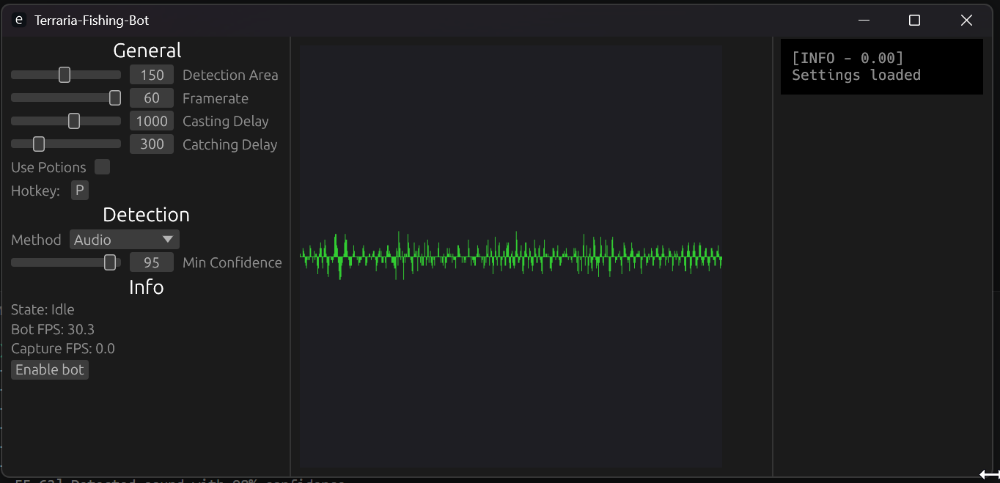
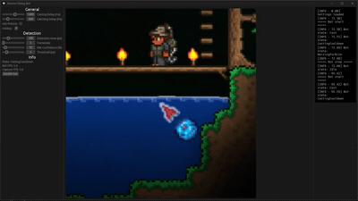
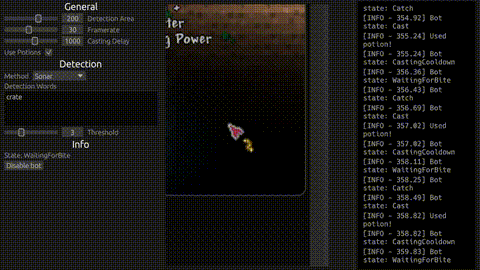
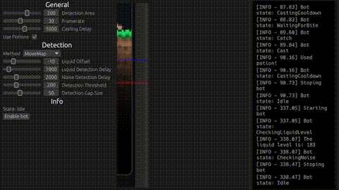

# Terraria Fishing Bot

Terraria advanced fishing bot, written entirely in Rust. Created for practicing/learning Rust.

## Features

- Reliable fishing in water/lava/honey
- 5 detection methods:
  - Audio (ONNX Neural Network model)
  - YOLO (Bobber position tracking)
  - OCR (Text detection)
  - Movemap (Pixel movement tracking)
  - Yolo+Audio (Less false positives)
- Reliable fishing with noise like enemies
- GUI interface
- Automatic potion use
- Working with sonar potion
- Saving settings

## Preview

### Audio method

### YOLO method

### OCR method

### Movemap method

## Manual

1. Download the executable file from the releases tab in this repository.
3. Run the executable file.
4. Configure settings in the GUI and select your preferred detection method.
5. Set your cursor slightly below where you want to fish.
6. Press P to start/stop. Do not move the cursor or your character while active (except Audio method).

## Things to Know

### General
- The bot tracks the area around your cursor.
- The sound capture from the entire computer, not just the game.

### Audio Method
- It works almost all the time, even with some noise - as long as it's not excessive.

### OCR Method
- Requires Sonar Potions to detect fish text overlays.
- The higher the margin, the lower fps.
- It works inconsistently because it uses a generic model. In the future, there will be a specialized one that will work better.

### YOLO Method
- It runs fairly smoothly but uses a lot of CPU resources, better to lower the frame rate.

### Yolo+Audio Method
- Make less false positives.
- Only catch if both of detectors triggered.

### Movemap Method
- The bot WILL NOT WORK in movemap mode if you do not have waves enabled in Terraria settings.
- The bot may not work properly in the Underworld due to heat distortion. Setting a contrasting background can help.
- During heavy rain, false alarms may occur. Building a roof overhead prevents this.
- While fishing in lava, increase the gap size, threshold, and noise delay settings to account for lava bubbles.
- All in all, it's unreliable - it's better to use other options - but it's the fastest.
